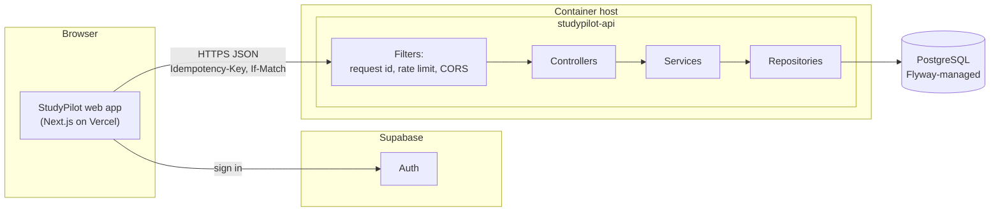
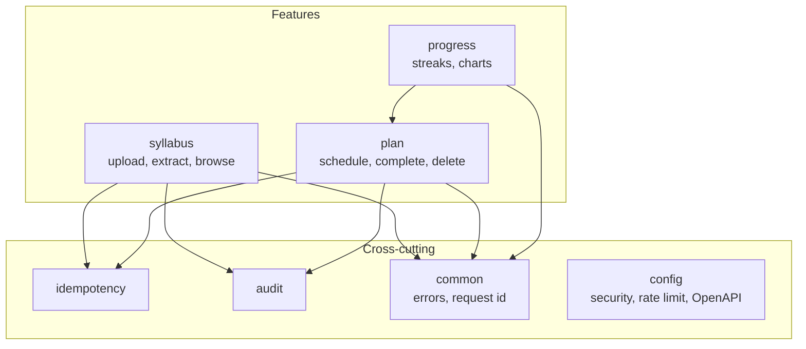
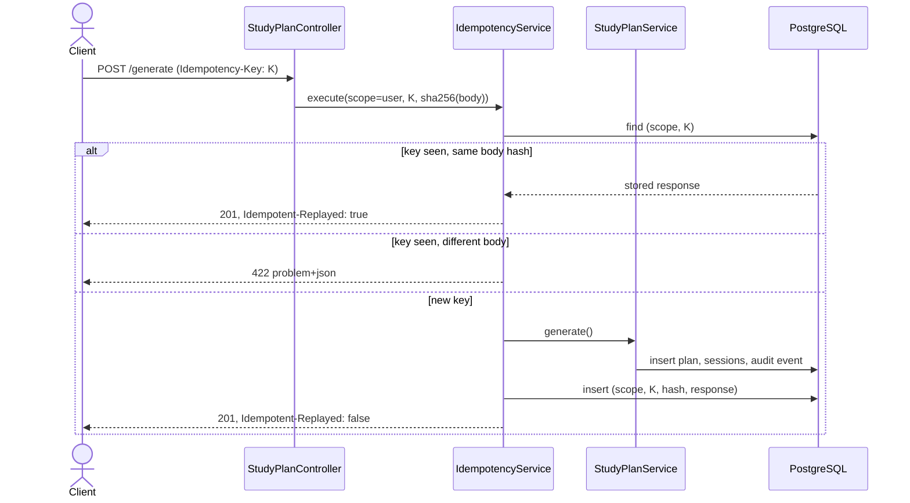

<div align="center">

# StudyPilot API

**Turns a course syllabus PDF into a dated study plan, then tracks completion, streaks and progress.**<br />
The Spring Boot backend for [StudyPilot](https://github.com/C-J7/studypilot), built to the standards of a transactional system: idempotent writes, optimistic locking, an append-only audit trail and versioned schema migrations.

[](https://openjdk.org/projects/jdk/21/)
[](https://spring.io/projects/spring-boot)
[](https://www.postgresql.org)
[](https://flywaydb.org)
[](https://github.com/C-J7/SP/actions/workflows/ci.yml)

[Live app](https://studypilot.vercel.app) · [Live API docs](https://sp-5rvl.onrender.com/swagger-ui.html) · [Health](https://sp-5rvl.onrender.com/actuator/health) · [Architecture](#architecture) · [Engineering decisions](#engineering-decisions)

</div>

---

## Contents

- [What it does](#what-it-does)
- [Try it in two minutes](#try-it-in-two-minutes)
- [Tech stack](#tech-stack)
- [Architecture](#architecture)
- [Engineering decisions](#engineering-decisions)
- [API](#api)
- [Getting started](#getting-started)
- [Project structure](#project-structure)
- [Security](#security)
- [Quality checks](#quality-checks)
- [Deploying](#deploying)
- [Progress and roadmap](#progress-and-roadmap)
- [Known issues](#known-issues)

## What it does

| Area | What it does | Endpoints |
|------|--------------|-----------|
| Syllabus ingestion | Validates an uploaded PDF by magic bytes, encryption and page count, extracts topics from bullets, numbered lists and "Week N:" lines, and stores a SHA-256 checksum of the file | `POST /api/syllabus/upload`, `GET /api/syllabus`, `/search`, `/user/{id}` |
| Plan scheduling | Spreads topics evenly over a date range, places a daily study window at the preferred time and moves it around busy blocks | `POST /api/study-plan/generate` |
| Session tracking | Marks sessions done or not done, guarded by ETag and `If-Match` | `PUT /api/study-plan/{plan}/session/{session}` |
| Progress | Completion rate, current and longest streak, hours per day for the last week, active days per week, completion per course | `GET /api/study-plan/user/{id}/progress` |
| Upcoming work | Next incomplete sessions across all plans | `GET /api/study-plan/user/{id}/upcoming` |
| Audit trail | Every state change, with actor, time and request id, paged newest first | `GET /api/audit/user/{id}` |
| Operations | Liveness and readiness probes, build info, metrics, OpenAPI 3 spec and Swagger UI | `/actuator/*`, `/v3/api-docs`, `/swagger-ui.html` |

## Try it in two minutes

1. Open the [live app](https://studypilot.vercel.app/login) and choose **Explore the demo**. The demo account is seeded on every boot with two courses, a live streak and a broken one, so every chart has data.
2. Tick off a session, then watch progress and the [audit trail](https://sp-5rvl.onrender.com/api/audit/user/demo-user) update.
3. Upload [`docs/sample-syllabus.pdf`](docs/sample-syllabus.pdf) and generate a plan from it.
4. Or skip the UI and drive the API from [Swagger UI](https://sp-5rvl.onrender.com/swagger-ui.html).

```bash
# Generate a plan twice with the same key: one plan is created, the second call replays it.
curl -i -X POST https://sp-5rvl.onrender.com/api/study-plan/generate \
  -H 'Content-Type: application/json' -H 'Idempotency-Key: demo-0001-retry-safe' \
  -d '{"syllabusId":1,"userId":"demo-user","startDate":"2026-11-02","endDate":"2026-11-20","hoursPerDay":2,"preferredTime":"evening"}'
```

The demo runs on the Render free tier with an in-memory database, so it sleeps after 15 minutes idle (the first request can take about a minute) and resets on restart.

## Tech stack


| Layer | Choice | Why |
|-------|--------|-----|
| Runtime |  | LTS; records for DTOs and value types |
| Framework |  | Web, Validation, Data JPA, Security, Actuator |
| Database |  -1F4E79) | Postgres in production; H2 in PostgreSQL mode for the demo and tests, against the same migrations |
| Schema |  | Versioned SQL; Hibernate only validates, it never alters the schema |
| PDF |  | Text extraction with page and encryption checks |
| API docs |  | springdoc generates the spec from the controllers |
| Delivery |   | Layered non-root image; CI runs tests, boots on real Postgres and builds the image |

## Architecture

### System overview



### Layers and features

The code is packaged by feature, not by layer, so each capability is self-contained:



### Generating a plan safely under retries



The plan, its sessions, the audit event and the idempotency record are written in one transaction. If two requests race with the same key, the primary key on `(scope, key)` makes one of them fail; it returns 409 and everything it wrote rolls back, so a network retry can never create a second plan.

## Engineering decisions

| Concern | What the API does | Where |
|---------|-------------------|-------|
| Retries and duplicates | `Idempotency-Key` on both POST endpoints. Same key and payload replays the stored response; a different payload is 422; a concurrent duplicate is 409. Records always INSERT, never merge, so a race cannot overwrite | [`IdempotencyService`](src/main/java/com/studypilot/idempotency/IdempotencyService.java) |
| Lost updates | `@Version` on the plan, exposed as the ETag. Editing a session touches the plan, so the version moves and a stale `If-Match` gets 412 | [`StudyPlanService`](src/main/java/com/studypilot/plan/StudyPlanService.java) |
| Auditability | Append-only `audit_events`, mapped `@Immutable`, written with `Propagation.MANDATORY` so an audit row exists only if the change it describes committed | [`AuditService`](src/main/java/com/studypilot/audit/AuditService.java) |
| Traceability | `X-Request-Id` accepted from a gateway (validated against a safe pattern) or generated, put in the logging MDC, echoed in the response, stored on audit rows and returned in every error body | [`RequestIdFilter`](src/main/java/com/studypilot/common/RequestIdFilter.java) |
| Error contract | RFC 9457 `problem+json` for every failure, with stable `type` URIs documented in [`docs/errors.md`](docs/errors.md). Internal exception text is logged, never returned | [`ApiExceptionHandler`](src/main/java/com/studypilot/common/ApiExceptionHandler.java) |
| Schema change | Flyway owns the schema; Hibernate runs in `validate` mode, so a mapping that drifts from the database fails at startup instead of in production traffic. CI boots the app against real PostgreSQL to prove the migrations | [`V1__init_schema.sql`](src/main/resources/db/migration/V1__init_schema.sql) |
| Abuse | Per-client token bucket on `/api/**` returning 429 with `Retry-After`; upload size, page count and topic count caps | [`RateLimitFilter`](src/main/java/com/studypilot/config/RateLimitFilter.java) |
| Deterministic time | A `Clock` bean is injected wherever "now" matters, so scheduling and streak logic are testable without sleeping or mocking statics | [`StudyPilotApplication`](src/main/java/com/studypilot/StudyPilotApplication.java) |
| Pure core logic | The scheduler is a static, framework-free function with its own unit tests, including month boundaries and busy-block placement | [`SessionScheduler`](src/main/java/com/studypilot/plan/SessionScheduler.java) |

## API

Base URL for the live demo: `https://sp-5rvl.onrender.com`. The full contract is in [Swagger UI](https://sp-5rvl.onrender.com/swagger-ui.html).

| Method | Path | Notes |
|--------|------|-------|
| POST | `/api/syllabus/upload` | multipart: `file`, `title`, `faculty`, `department`, `semester`, `userId`. Optional `Idempotency-Key`. 201 with extracted topics and the file's SHA-256 |
| GET | `/api/syllabus` | Catalogue; optional `faculty`, `department`, `semester` |
| GET | `/api/syllabus/search` | Same filters plus `search` over title and topics |
| GET | `/api/syllabus/user/{userId}` | A user's uploads, newest first |
| POST | `/api/study-plan/generate` | JSON: `syllabusId`, `userId`, `startDate`, `endDate`, optional `hoursPerDay` (1 to 8, default 2), `preferredTime` (`morning`, `afternoon`, `evening`), `busyHours` keyed by date. Max 180 days |
| GET | `/api/study-plan/{id}` | Returns `ETag` |
| PUT | `/api/study-plan/{plan}/session/{session}?completed=true` | Optional `If-Match`; returns the new `ETag` |
| DELETE | `/api/study-plan/{id}` | 204 |
| GET | `/api/study-plan/user/{userId}` | All plans with sessions |
| GET | `/api/study-plan/user/{userId}/upcoming?limit=5` | Next incomplete sessions |
| GET | `/api/study-plan/user/{userId}/progress` | Totals, streaks, last 7 days, last 4 weeks, per course |
| GET | `/api/audit/user/{userId}?page=0&size=20` | Paged audit events |

Error responses and their meaning are listed in [`docs/errors.md`](docs/errors.md).

## Getting started

Requirements: JDK 21. Maven is not needed; the wrapper downloads it. Docker is optional.

```bash
# Zero setup: in-memory database, seeded demo account, http://localhost:8080/swagger-ui.html
./mvnw spring-boot:run

# Production-like: PostgreSQL plus the API on the prod profile
docker compose up --build
```

| Variable | Default | What it does |
|----------|---------|--------------|
| `SPRING_PROFILES_ACTIVE` | `demo` | `demo` uses in-memory H2 and seeds `demo-user`; `prod` requires the `DB_*` variables |
| `DB_URL` | none in `prod` | JDBC URL, for example `jdbc:postgresql://host:5432/studypilot?sslmode=require` |
| `DB_USERNAME`, `DB_PASSWORD` | none in `prod` | Database credentials, supplied by the host's secret store |
| `PORT` | `8080` | HTTP port |
| `CORS_ALLOWED_ORIGINS` | `http://localhost:3000,https://studypilot.vercel.app` | Comma-separated origins allowed to call the API |
| `RATE_LIMIT_CAPACITY`, `RATE_LIMIT_REFILL_PER_MINUTE` | `60`, `60` | Token bucket size and refill rate per client |

## Project structure

```text
src/main/java/com/studypilot
  StudyPilotApplication.java   entry point and Clock bean
  syllabus/                    upload, PDF validation, topic extraction, catalogue
  plan/                        scheduler, plans, sessions, ETag handling
  progress/                    streak and chart calculations
  audit/                       append-only audit trail
  idempotency/                 Idempotency-Key storage and replay
  common/                      problem+json handler, request id filter, exceptions
  config/                      security headers, CORS, rate limiting, OpenAPI
  demo/                        seed data for the demo profile only
src/main/resources
  application.yml              profiles: demo (default), prod
  db/migration/                Flyway SQL
src/test/java/com/studypilot   unit and HTTP integration tests
docs/                          error reference, sample syllabus PDF
```

## Security

| Area | What the API does | Where |
|------|-------------------|-------|
| Transport and headers | HSTS, `X-Content-Type-Options`, `X-Frame-Options: DENY`, `Referrer-Policy: no-referrer` | `SecurityConfig` |
| CORS | Explicit origin allow-list from configuration; only the headers the client needs are allowed or exposed | `SecurityConfig` |
| Input | Bean Validation on every body and parameter; user ids restricted to `[A-Za-z0-9_-]{1,64}`; request ids pattern-checked to block log injection | controllers, `RequestIdFilter` |
| Uploads | Magic-byte check, encrypted PDFs rejected, 10 MB and 100 page caps, original filename normalised, SHA-256 recorded | `TopicExtractor`, `SyllabusService` |
| Secrets | None in the repository; database credentials come from the environment | `application.yml` |
| Container | Non-root user, JRE-only runtime image, health check, `ExitOnOutOfMemoryError` | `Dockerfile` |
| Errors | No stack traces or exception messages in responses | `ApiExceptionHandler` |

Limit to be aware of: the API trusts the `userId` the client sends. The web app authenticates users with Supabase, but the API does not yet verify the Supabase JWT, so any caller can read or write any user's data. That is the first item on the roadmap.

## Quality checks

```bash
./mvnw verify
```

23 tests, all passing on the last run:

| Suite | Kind | Covers |
|-------|------|--------|
| `SessionSchedulerTest` (8) | Unit | Even spreading in both directions, window splitting, month boundaries, busy-block shifting and skipping, empty and impossible ranges |
| `TopicExtractorTest` (4) | Unit | Bullet, numbered and "Week N" formats, de-duplication, real PDF extraction, non-PDF rejection |
| `ProgressServiceTest` (4) | Unit | Current streak including the "not yet today" case, longest streak |
| `StudyPilotApiTest` (7) | Integration, full Spring context, Flyway schema on H2 | Idempotent replay, key reuse rejection, problem+json with request id, 404s, ETag and 412, audit ordering, disguised-PDF rejection, health and OpenAPI |

CI ([`ci.yml`](.github/workflows/ci.yml)) runs the suite, boots the jar against a PostgreSQL 17 service to validate the migrations on the real engine, and builds the container image. Dependabot keeps Maven, Actions and Docker base images current.

## Deploying

| You do | What happens |
|--------|--------------|
| Open a pull request | CI runs tests, the PostgreSQL boot check and the image build |
| Merge to `main` | The image is the deployable artifact; any container host works (Render, Fly.io, Cloud Run, Kubernetes) |
| Set `SPRING_PROFILES_ACTIVE=prod` and the `DB_*` secrets | Flyway migrates on startup, Hibernate validates, readiness turns green at `/actuator/health/readiness` |

The public demo is a Render free web service that builds this repository's Dockerfile from `main` on the default `demo` profile.

## Progress and roadmap

**Completed**

- [x] Feature-packaged Spring Boot 3.4 service on Java 21 with Flyway, validation and Actuator
- [x] Idempotent POSTs, ETag concurrency control, append-only audit trail, request correlation, rate limiting
- [x] RFC 9457 errors with a documented catalogue
- [x] Unit and HTTP integration tests; CI with a real PostgreSQL boot; Dependabot
- [x] Live demo with seeded data, wired to the web app

**Next**

| Phase | Focus | Highlights |
|-------|-------|------------|
| 1 | Identity | Verify Supabase JWTs as an OAuth2 resource server; derive the user from the token and drop `userId` from paths |
| 2 | Resilience | Redis-backed rate limits and idempotency expiry; Testcontainers for PostgreSQL in the test suite |
| 3 | Observability | Prometheus metrics, OpenTelemetry tracing, structured JSON logs |
| 4 | Product | Reminders by email, Google Calendar export, smarter topic extraction for tabular outlines |

## Known issues

| # | Issue | Impact | Workaround or plan |
|---|-------|--------|--------------------|
| 1 | The API does not verify identity | Any caller can act as any `userId` | Roadmap phase 1: JWT verification. Do not store real personal data until then |
| 2 | Demo data lives in memory | The public demo resets when the Space restarts or sleeps | Use the `prod` profile with PostgreSQL for anything persistent |
| 3 | Rate limits are per instance | Limits multiply when scaled horizontally | Roadmap phase 2: shared store |
| 4 | Topic extraction expects list-like lines | Syllabi written as paragraphs or tables yield few or no topics | The API returns 422 with guidance; see `docs/sample-syllabus.pdf` for a working layout |
| 5 | Streak days use the server's time zone | A session ticked off near midnight may count toward the neighbouring day | Store the user's zone with the profile and compute per user |
